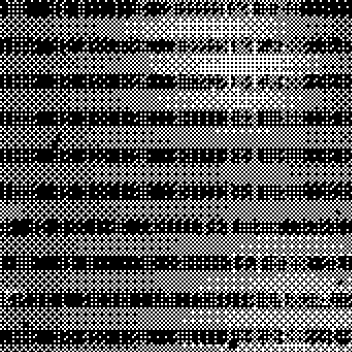
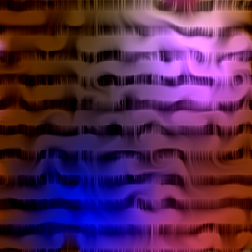
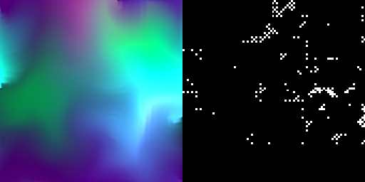

# The Forgetting and the Flow

*Degradation as method in a real-time image system.*

Two autonomous systems that degrade, dissolve and forget a finite archive of
images, continuously, in front of the viewer, without ever repeating
themselves. This repository is the logic of the work written out in plain
Python and NumPy, so that every rule by which it forgets can be read, run and
characterised, independently of the TouchDesigner network it was first built
in.

| The Forgetting | The Flow | both, on one deck |
|---|---|---|
|  |  |  |

*(Frames from runs on synthetic stand-in images; the archive itself is not in
this repository.)*

The artist statement and technical appendix are in
[docs/statement.md](docs/statement.md). What follows is how the code keeps to
them.

## Requirements

Python ≥ 3.10, NumPy and Pillow. Nothing else. The optional live window uses
`tkinter` from the standard library.

```bash
pip install numpy pillow
```

Run everything from this directory with `python3 -m forgetting_and_flow …`.

## Quickstart

```bash
# synthetic stand-in images, so the pipeline can be tried without the archive
python3 -m forgetting_and_flow demo-archive --out demo --n 12

# The Forgetting, headless, 30 seconds of nominal time, a PNG every 5 s
python3 -m forgetting_and_flow forgetting --archive demo --frames 1800 --save-every 300

# The Flow, live window (press f to forgive — there is nothing to forgive here — q to quit)
python3 -m forgetting_and_flow flow --archive demo --size 256 --display

# both systems side by side on the same shuffled deck, in study mode (seed recorded)
python3 -m forgetting_and_flow both --archive demo --size 256 --mode study --seed 7 --frames 1200

# the numbers in the appendix: contribution(N) = 1 - (1-k)^N
python3 -m forgetting_and_flow decay-table --k 0.06

# what a run left behind
python3 -m forgetting_and_flow summary --log runs/<run>/events.jsonl
```

Every run writes to `runs/<command>_<timestamp>/` (or `--out`): an
`events.jsonl` log, and PNG frames only if you ask for them with
`--save-every`.

## The two systems

### The Flow — forgetting as lossy recursion ([flow.py](forgetting_and_flow/flow.py))

A video feedback loop. Each frame's output is the next frame's input. The
loop body applies, in order: a sub-pixel zoom; advection by a curl-noise
vector field; self-refraction (the image displaced by the gradient of its own
blurred luminance); a mild diffusion; injection of the source image at rate
`k`; a slow hue rotation; a clamp.

Every pass is lossy. The displacements resample with bilinear interpolation
([ops.sample](forgetting_and_flow/ops.py)), which averages four neighbours
and discards whatever lived between them. No buffer stores the original
image; it exists only as a diminishing contribution inside the recursion:

```
contribution(N) = 1 - (1 - k)^N        k = 0.06
N = 11  ->  ~50% replaced      N = 75 (1.25 s at 60 fps)  ->  ~99% replaced
```

`tests/test_systems.py` checks this formula against the loop with transport
switched off; it holds to five decimal places. With transport on, the test
checks that correlation to a source collapses once the source is replaced.

The velocity field is the curl of a scalar noise field
([noise.py](forgetting_and_flow/noise.py)): its gradient rotated 90°, hence
divergence-free, so the churn swirls without drift and without sinks. The
test suite measures the divergence.

The display grade — luminance unsharp mask, contrast expansion — is applied
once per frame **outside** the loop (`Flow.display`). Inside it would compound
and destabilise; outside, it is a way of seeing the decay, not part of it.

### The Forgetting — forgetting as irreversible state ([forgetting.py](forgetting_and_flow/forgetting.py))

A single-channel memory mask, white = remembered, updated by a rule that can
only subtract:

```
mask(t+1) = clamp( mask(t) - bites(t) - edge_creep(t), 0, 1 )
```

`MemoryMask.step` is that line and nothing else, and it asserts after every
update that no pixel increased. The image stream is multiplied by the mask;
lost regions render as void. The mask persists across image changes, so
damage done while one image is on screen scars every image that follows.

* **bites** — sparse random blobs, reseeded for every image pair so the
  pattern never repeats;
* **edge creep** — erosion in proportion to how much void already surrounds
  a pixel; loss compounds at its own margins.

Above the erosion a glitch layer keeps the surface unstable: horizontal slice
bands tear sideways in discrete stutters, a chunky ordered dither turns tone
into crawling stipple, and a black-and-white contrast grade holds the material
in a harsh forensic register.

**Forgiveness is external.** `MemoryMask.forgive` is the only thing that can
restore the mask. The update rule never calls it. A running system receives it
only as a gesture from outside: a file named `FORGIVE` touched in the run
directory, or the `f` key in the live window. The run loop relays the gesture
and logs where it came from; it does not originate it. An optional rebirth
cycle for long installations (`--rebirth-every SECONDS`) is the same gesture on
a timer, logged as such.

### Shared

* **Deck.** The archive is dealt as a shuffled deck with no immediate repeats,
  reshuffled when exhausted ([archive.py](forgetting_and_flow/archive.py)).
  Crossfades ping-pong between two loader slots so the visible image never
  reloads mid-view.
* **Statefulness.** Both systems carry their whole history in their state
  (the loop buffer, the mask). The present frame is the sum of everything that
  has happened to it.
* **Non-repeatability.** Deck order, noise seeds and bite patterns are drawn
  fresh per run and per transition. In *performance* mode the seed comes from
  the operating system and is **not** recorded; the log says `withheld`. In
  *study* mode (`--mode study --seed N`) it is recorded so the dynamics can be
  characterised. This is the one place the code distinguishes an event from an
  experiment.
* **The log is what remains.** `events.jsonl` holds `run_start` (parameters,
  canvas, timebase, rates, environment), `image` events (`enter`, `surfaced`,
  `exit`, by filename), `metrics` at intervals, every `forgive` gesture and its
  result, `generation` write-backs in the terminal run, and `run_end`. Frames
  are not kept unless asked for.

## The terminal run ([terminal.py](forgetting_and_flow/terminal.py))

The work's final form adds one gesture to everything above: each image, every
time it surfaces, is written back to disk more degraded than it was loaded.
Generation by generation the archive consumes itself.

```bash
python3 -m forgetting_and_flow terminal --archive /path/to/the/archive --days 10 --consume
```

What the command does, exactly:

* **Overwrites** the image files in `--archive` in place, keeping names and
  formats, each time the image leaves the screen: the file as loaded is
  blended with what the running system made of it (`--generation-mix`,
  default 0.5); JPEGs are also re-encoded at a quality that falls by
  generation. The next deal of that image loads the degraded file.
* **Refuses to run without `--consume`.** It prints what it would do and
  exits.
* **Never deletes anything** — not images, not backups, not the log. The
  paper reserves the deletion of the last backup for the artist's own hand,
  before the run begins, because that responsibility cannot be automated.
  The code keeps that boundary.
* **Withholds forgiveness.** The signal file and the key are received and
  logged as `withheld`; the mask is never restored.
* Runs for `--days` of wall-clock time (or `--seconds`), logging each
  write-back with the file's generation count, mean, standard deviation,
  entropy and SHA-256.

A ten-day run at 60 fps nominal needs the erosion rates set far slower than
the defaults (see below); the write-back does most of the consuming.

## Timebase and speed

The TouchDesigner original runs at 60 frames per second on the GPU. This
port is NumPy on the CPU. Frames are the unit of time in all the rules; the
nominal `--fps` (default 60) only converts seconds in the options to frames.
Headless, the code runs as fast as it can; `--pace` (implied by `--display`)
sleeps to hold the nominal rate when it is ahead. On an Apple-silicon laptop:

| canvas | The Forgetting | The Flow |
|---|---|---|
| 512 × 512 | ~45 frames/s | ~8 frames/s |
| 256 × 256 | ~200 frames/s | ~40 frames/s |

Use `--size 256` for live viewing; render at 512 or above headless.

## Parameters

Erosion is given in human units and converted per canvas and timebase:

| option | default | meaning |
|---|---|---|
| `--bites-per-minute` | 2 | new bites over the whole canvas per minute |
| `--creep-px-per-minute` | 1 | speed of a void's edge |
| `--k` | 0.06 | The Flow's injection rate |
| `--hold` / `--fade` | 4 s / 1.5 s | time an image is held / crossfade |
| `--rebirth-every` | off | rebirth cycle in seconds |

The run announces an estimated half-life of the mask (time until half the
canvas is void), from the rates and bite size alone:

```
void(t) ≈ bites_per_frame · π · ( r0² t + r0 v t² + v² t³ / 3 )
```

solved for half the canvas, where `v` is the measured front speed of edge
creep (1.1 px per frame per unit creep rate; see the calibration test). The
estimate is within a factor of two of simulation; overlap slows the end. At
the defaults on a 512² canvas it is about an hour. Because wound area grows
with the cube of time, a run meant to last days needs rates orders of
magnitude lower, e.g. `--bites-per-minute 0.05 --creep-px-per-minute 0.002`.

Everything else (bite radius, dither grain, tear amplitude, refraction
strength, hue speed, display grade…) is a field on `ForgettingParams` or
`FlowParams`, set in code.

## Glossary: system terms as code

| system term | memory analogue | where |
|---|---|---|
| feedback loop | each remembering takes the previous remembering as input | `Flow.step` |
| lossy resampling | the distortion of every act of recall | `ops.sample` |
| injection rate `k` | the waning voice of the original inside its retellings | `FlowParams.k` |
| exponential decay | how fast the event, as opposed to its story, disappears | `flow.contribution` |
| accumulator / monotonic state | what is forgotten stays forgotten | `MemoryMask.step` |
| edge creep | loss breeding loss at the margins of what is already gone | `MemoryMask._edge_creep` |
| random seeds, shuffled deck | no two rememberings are the same | `Deck`, `choose_seed` |
| manual reset (forgive) | recovery only as an act from outside | `MemoryMask.forgive`, the `FORGIVE` file |
| generation write-back | a copy of a copy of a copy | `Consumer.write_back` |

## Tests

```bash
python3 -m unittest -v
```

Twenty-two tests, each a claim from the appendix: the mask never increases
and void is absorbing; creep acts only at margins; forgiveness restores and
can be withheld; the decay formula; the curl field's divergence; no immediate
repeats in the deck; performance mode withholds the seed; the signal file is
consumed and logged; the terminal run changes every file and deletes none.

## Layout

```
forgetting_and_flow/
  ops.py         resampling, blur, hue, display grade — the lossy primitives
  noise.py       3-D lattice noise and the curl (divergence-free) field
  archive.py     listing, loading, deck, two-slot crossfader, demo images
  flow.py        The Flow
  forgetting.py  The Forgetting: memory mask, glitch layer
  runner.py      run loop, forgiveness relay, metrics, frames
  terminal.py    generation write-back (the archive consuming itself)
  eventlog.py    JSONL log, seed policy
  display.py     optional tkinter window
  cli.py         commands
tests/test_systems.py
docs/statement.md
```

## What is not here

The archive. The source images are private and, in the work's final form,
consumed. `demo-archive` writes meaningless stand-ins so the code can be run
and checked; they are not the material.

## License

Code: MIT (see [LICENSE](LICENSE)). The text in `docs/statement.md` is the
author's and is not covered by the code license.


## How this was made

The method is mine: the TouchDesigner network of *The Forgetting and the Flow*, its rules and its artist statement. The mappings, the rules and the artistic decisions are mine too.

This repository is a 2026 reference implementation of that method. It was written with an AI coding assistant (Claude, by Anthropic) working under my direction, and the commit history records this. I disclose it in the spirit of the AI Use Log I ask my students to keep: who made what, and with which tools, should be visible in the work.
